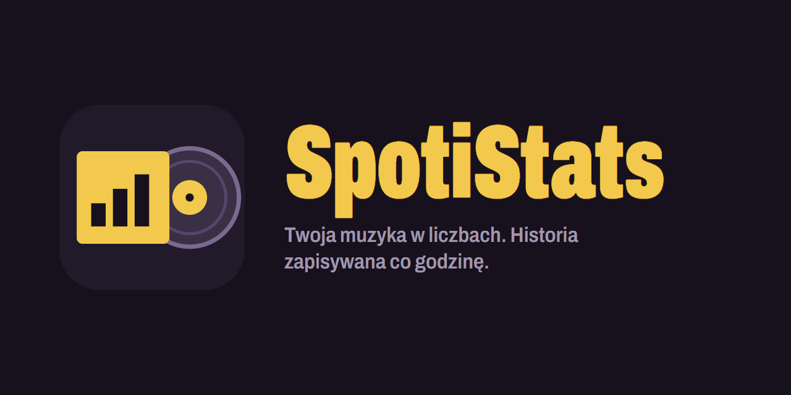
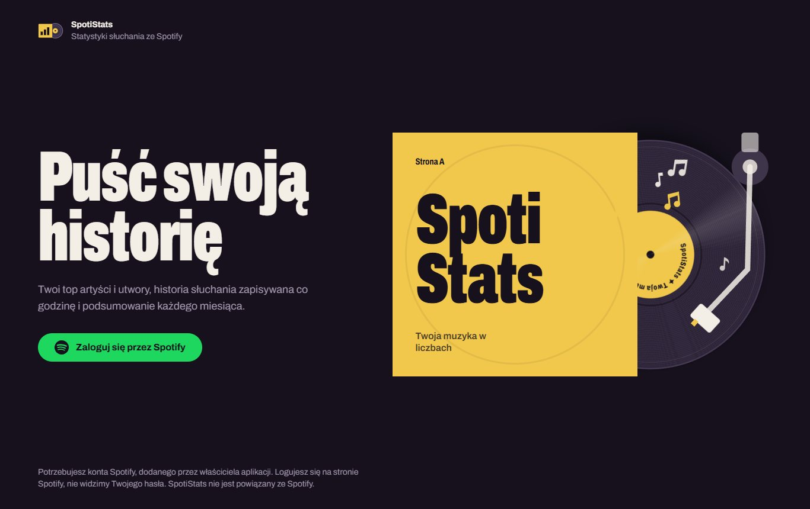
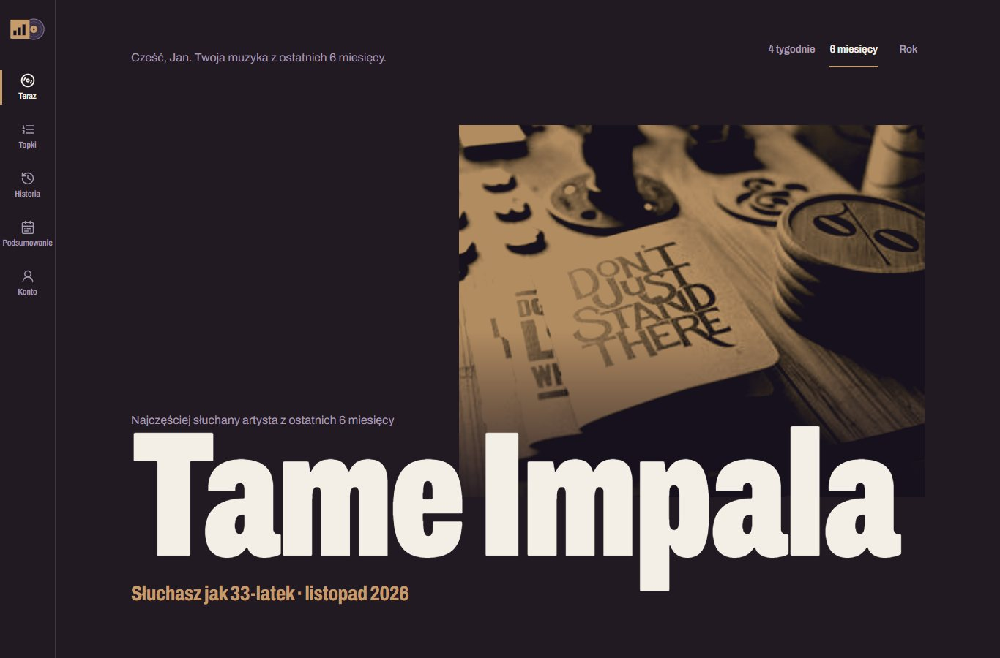
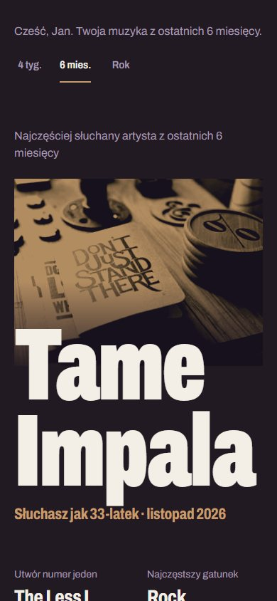
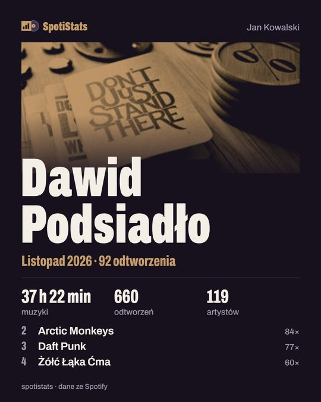

<p align="center">
  
</p>

<p align="center">
  Personal Spotify listening stats: history collected every hour, top artists and tracks, monthly summaries and a shareable poster card.
</p>

<p align="center">
  
  
  
  
</p>

## Screenshots

| Login | Teraz (dashboard) |
|---|---|
|  |  |

| Mobile | Share card |
|---|---|
|  |  |

## Features

- **Hourly history collection.** Spotify's API only remembers your last 50 plays; SpotiStats saves them every hour (Cloud Scheduler), keeps collecting after you log out, detects gaps and estimates real listening time from the gap between plays.
- **Teraz.** Your #1 artist as a gig poster, key numbers, top lists, the week in bars, genres and what you just played.
- **Topki.** Top artists and tracks for 4 weeks, 6 months or a year.
- **Historia.** Listener profile, golden hours, listening calendar with streaks, prediction and discovery roulette.
- **Podsumowanie.** Any month or year on demand: minutes, plays, artists and active days vs the previous period, first-time artists, longest streak.
- **Share card and CSV.** A 1080×1350 poster PNG of your month and your full history as an Excel-safe CSV.
- **Konto.** Collection status, last sync, export, stop collecting, delete account.
- **GDPR import.** Load Spotify's extended streaming history to see years before you joined.
- **Your colours.** The accent is taken from your #1 artist's photo (contrast-checked), so the app looks different for everyone.

## Design

A "gig poster" look: one variable typeface ([Archivo](https://fonts.google.com/specimen/Archivo), width 62–125), a plum-ink ground, warm paper text, 4 px corners, no cards or gradients. The login screen is a record that slides out of the SpotiStats sleeve and plays. Details in [UI_DESIGN_SYSTEM.md](./UI_DESIGN_SYSTEM.md); logo files in [docs/brand](./docs/brand).

## Tech Stack

| Layer | Technology |
|-------|------------|
| **Frontend** | React 18, TypeScript, Vite, Tailwind CSS, TanStack Query |
| **Backend** | Node.js 22, Express, Prisma ORM |
| **Database** | PostgreSQL (Supabase) |
| **Hosting** | Google Cloud Run, Cloud Scheduler (hourly sync), GitHub Actions deploy |
| **Auth** | OAuth 2.0 + PKCE, JWT in HttpOnly cookies, rotating refresh tokens |
| **Security** | Helmet, CSP, CSRF double-submit, rate limiting, AES-256-GCM token encryption |
| **Observability** | Prometheus metrics, Sentry, Cloud Monitoring alert policies ([docs/monitoring](./docs/monitoring)) |

## 🚀 Quick Start

### Prerequisites

- Node.js 22+
- PostgreSQL database (or [Supabase](https://supabase.com) free tier)
- [Spotify Developer App](https://developer.spotify.com/dashboard)

### 1. Clone & Setup

```bash
git clone https://github.com/izimen/spotistats.git
cd spotistats
```

### 2. Spotify Developer Setup

1. Go to [Spotify Developer Dashboard](https://developer.spotify.com/dashboard)
2. Create a new application
3. Add Redirect URI: `http://127.0.0.1:5000/auth/callback` (Spotify rejects `localhost` — use the loopback IP, or HTTPS)
4. Owner of the app needs Spotify Premium; in Development Mode add every user (max 5) under *User Management*
5. Copy your **Client ID** and **Client Secret**

### 3. Backend Configuration

```bash
cd backend

# Install dependencies
npm install

# Optional: Install monitoring packages
npm install prom-client @sentry/node

# Create environment file
cp .env.example .env
```

Edit `.env` with your credentials:
```env
DATABASE_URL="postgresql://..."
SPOTIFY_CLIENT_ID=your_client_id
SPOTIFY_CLIENT_SECRET=your_client_secret
JWT_SECRET=your_random_32_char_secret
ENCRYPTION_KEY=your_separate_encryption_key
CRON_SECRET_KEY=your_random_cron_secret
SPOTIFY_REDIRECT_URI=http://127.0.0.1:5000/auth/callback
FRONTEND_URL=http://localhost:8080
APP_TIMEZONE=Europe/Warsaw  # Optional, used for hour/weekday stats
SENTRY_DSN=your_sentry_dsn  # Optional
```

```bash
# Setup database
npx prisma generate
npx prisma migrate dev

# Start server
npm run dev
```

### 4. Frontend Configuration

```bash
cd ../frontend
npm install
npm run dev
```

### 5. Open the App

Visit `http://localhost:8080` and log in with Spotify. To work on the UI without a backend, run `VITE_PREVIEW_MODE=true npm run dev` in `frontend/` (mock data).

## 📁 Project Structure

```
spotistats/
├── backend/
│   ├── src/
│   │   ├── controllers/    # Route handlers
│   │   ├── services/       # Business logic
│   │   ├── middleware/     # Auth, rate limiting, metrics
│   │   └── routes/         # API endpoints
│   └── prisma/             # Database schema
│
└── frontend/
    └── src/
        ├── pages/          # Main views
        ├── components/     # Reusable UI
        ├── lib/            # API client, accent colour, share card
        └── hooks/          # Data hooks (TanStack Query)
```

## 🔐 API Endpoints

All API endpoints use versioned paths: `/api/v1/*`

> ⚠️ Legacy unversioned `/api/*` routes have been removed. Use `/api/v1/*` only.

| Method | Endpoint | Description |
|--------|----------|-------------|
| `GET` | `/auth/login` | Initiate Spotify OAuth |
| `GET` | `/auth/callback` | OAuth callback handler |
| `GET` | `/auth/me` | Get current user |
| `POST` | `/auth/logout` | End session (collection keeps running) |
| `POST` | `/auth/disconnect` | Stop background collection |
| `DELETE` | `/auth/me` | Delete account and all stored history |
| `GET` | `/api/v1/stats/top-artists` | Top artists (`time_range`, `limit` ≤ 50, cached 24 h) |
| `GET` | `/api/v1/stats/top-tracks` | Top tracks |
| `GET` | `/api/v1/stats/top-albums` | Top albums (derived from top tracks) |
| `GET` | `/api/v1/stats/recent` | Recently played (also stores the plays in history) |
| `GET` | `/api/v1/stats/overview` | Totals from the GDPR import |
| `GET` | `/api/v1/stats/listening-history` | Stored history: plays, totals, most looped, hour distribution |
| `GET` | `/api/v1/stats/listening-history/chart` | Plays per weekday |
| `GET` | `/api/v1/stats/listening-history/heatmap` | Plays per hour (all time) |
| `POST` | `/api/v1/stats/listening-history/sync` | Sync recently played now |
| `GET` | `/api/v1/stats/listening-history/export` | Full stored history as CSV |
| `GET` | `/api/v1/stats/insights/summary` | Period summary (`from`, `to` = `YYYY-MM-DD`, `to` exclusive, local time; default: current month) |
| `GET` | `/api/v1/stats/insights/calendar` | Plays per day + streaks (`days` 7–730, default 365) |
| `GET` | `/api/v1/stats/dna` | Music DNA (needs audio-features — unavailable to dev-mode apps, returns `null`) |
| `GET` | `/api/v1/stats/prediction` | Listening prediction |
| `GET` | `/api/v1/stats/discovery/roulette` | Music discovery |
| `POST` | `/api/v1/import/upload` | Import GDPR data |
| `GET` | `/metrics` | Prometheus metrics |
| `GET` | `/health` | Health check |

> 📝 **Error Format**: All errors follow [RFC 7807 Problem Details](https://datatracker.ietf.org/doc/html/rfc7807) with `application/problem+json` content-type.

## 🔒 Security

- **Authentication**:
  - OAuth 2.0 with PKCE flow
  - Stateless JWT implementation with automatic rotation
  - HttpOnly, Secure, SameSite=Strict cookies
- **Protection**:
  - **CSRF**: Double Submit Cookie pattern with cryptographic tokens
  - **XSS**: Strict Content Security Policy (CSP) and input sanitization
  - **Rate Limiting**: Per-user limits (Redis-backed when `REDIS_URL` is set, in-memory otherwise)
  - **Audit Logging**: Logging of sensitive actions to stdout (Cloud Logging compatible)
- **Resilience**:
  - **Circuit Breaker**: Fail-fast on Spotify API failures
  - **Request Timeout**: 5s timeout on external calls
  - **Backoff with Jitter**: ±50% jitter to prevent thundering herd
- **Data Protection**:
  - AES-256-GCM encryption for stored refresh tokens (separate ENCRYPTION_KEY)
  - GDPR-compliant data export and deletion

> 🛡️ **See also:** [Full Security Policy](./SECURITY.md)

## 🧪 Testing

```bash
cd backend
npm test
npm run test:watch  # Watch mode
```

## 🚢 Deployment

See [GCP_DEPLOYMENT.md](./GCP_DEPLOYMENT.md) for Google Cloud Platform deployment guide with:
- Cloud Run (backend)
- Cloud Build (CI/CD)
- Secret Manager

Live URLs, cost guards, Spotify API limits in 2026 and what to do when it breaks (Supabase paused, Spotify dev-mode limits): [docs/OPERATIONS.md](./docs/OPERATIONS.md).

## 📄 License

MIT

---

<p align="center">
  Built on the <a href="https://developer.spotify.com/documentation/web-api">Spotify Web API</a>. SpotiStats is not affiliated with Spotify AB.
</p>
